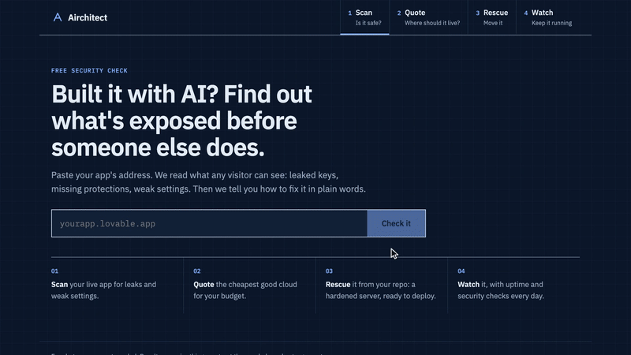

# Airchitect



Get a web app you built (often with an AI tool) safely onto a server you can afford.

Project site: https://abozaralizadeh.github.io/Airchitect/ · [Full demo video (MP4)](site/demo/tour.mp4)

Airchitect does four things:

- **Scan** a live app for leaked keys, missing security headers and weak settings, and explain the fixes in plain words.
- **Quote** where to host it. It compares European and US cloud providers by price, reliability and tooling and gives you three options.
- **Rescue** a GitHub repo or local folder. It checks the code for problems and writes a deploy kit: Dockerfile, Docker Compose, Caddy with HTTPS, a hardened server setup, backups and a runbook.
- **Watch** the app once it's live: uptime every 5 minutes, certificate expiry and a daily security rescan.

It also comes as a CLI and an MCP server, so coding agents can use it directly.

> Status: early beta. "Airchitect" is a working name and will change. See [CHECKLIST.md](CHECKLIST.md) for what works, what's faked and what's missing.

## Quick install

You need Node.js 24 or newer.

```bash
git clone <this repo> airchitect && cd airchitect
```

```bash
cd backend && npm install && npm run dev
```

In a second terminal:

```bash
cd frontend && npm install && npm run dev
```

Open http://localhost:5173. The API runs on port 8790.

### Run it on a server

On a fresh Ubuntu VM:

```bash
sudo ./setup_service.sh
```

It installs Node and Caddy, builds the app and starts the `airchitect` service. To use your own domain, run `sudo DOMAIN=app.example.com ./setup_service.sh` instead. Without a domain, the script uses `<ip>.sslip.io`. Rerun it any time to update. Logs:

```bash
journalctl -u airchitect.service -f
```

### Use it from the command line

```bash
cd backend && npm run build
```

```bash
node dist/cli.js scan example.com
```

```bash
node dist/cli.js rescue ./my-app --out ./my-app
```

### Use it from a coding agent

After `npm run build`, add the MCP server to any MCP client:

```json
{ "mcpServers": { "airchitect": { "command": "node", "args": ["/path/to/airchitect/backend/dist/mcp.js"] } } }
```

The agent gets three tools: `scan_url`, `quote_cloud` and `rescue_project`.

## Run the tests

```bash
cd backend && npm test
```

Type checks:

```bash
cd backend && npm run typecheck
```

## How it works

See [docs/architecture.md](docs/architecture.md).

## Contributing

Issues and pull requests are welcome. Read [CONTRIBUTING.md](CONTRIBUTING.md) first, because contributions come with a licensing condition.

## License

Source available, free for non-commercial use ([PolyForm Noncommercial 1.0.0](LICENSE)). You can use it, study it, change it and share it for anything that isn't commercial. Commercial use needs written permission: ask by opening a GitHub issue.

Docs, screenshots and the demo video are under [CC BY-NC 4.0](LICENSE-docs.md). The deploy kits the tool generates for you are yours to use however you like, commercially too. Third-party parts keep their own licenses, see [THIRD_PARTY_NOTICES.md](THIRD_PARTY_NOTICES.md).
