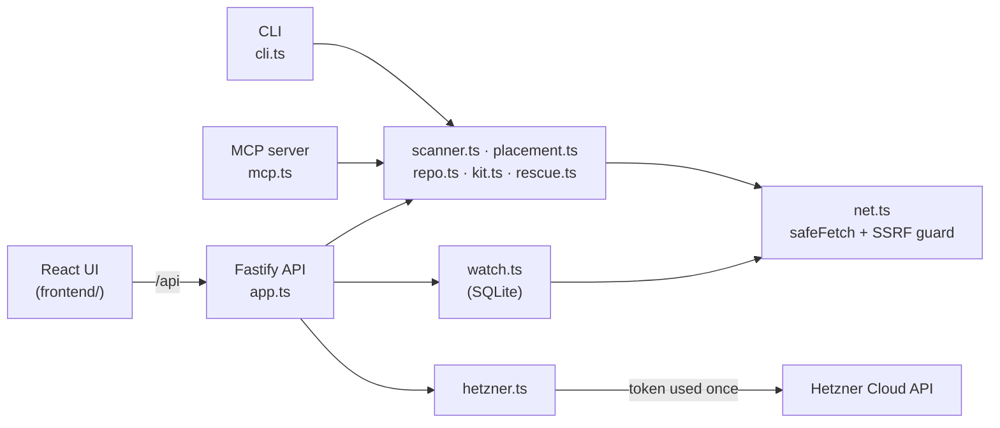

# Architecture

How the code is put together today. It's one Node.js backend that serves the API and the built frontend, plus a CLI and an MCP server that reuse the same modules.

## The four features

**Scan** (`scanner.ts`, `secrets.ts`). Fetches the page and up to 40 of the site's own scripts, following chunk imports. Checks TLS, the http to https redirect, security headers, cookies, open CORS, mixed content, source maps and leaked keys. Keys are always masked in output. If the owner proves the site is theirs (a token in `/.well-known/runvale-verify.txt` or in the homepage HTML), two deeper checks run: exposed files (`/.env`, `/.git/config`, `/.DS_Store`) and whether Supabase tables are readable with the public key. Only table names are reported, never rows. Each finding takes points off a score of 100 (critical 45, high 18, medium 7, low 2), and any critical finding means an F.

**Quote** (`placement.ts`, `data/providers.json`). Sizes the server from expected users and whether there's a database, then prices every matching plan with traffic and backups included. The score is 50% price, 20% reliability, 15% ops tooling and 15% price stability. It returns three picks: Budget (cheapest), Balanced (best score) and Premium (cheapest option that's clearly more trusted than the other two, even if over budget).

**Rescue** (`repo.ts`, `kit.ts`, `rescue.ts`). Loads a public GitHub repo through `codeload.github.com` (size and file count limits apply) or a local folder (CLI and MCP only). It detects the stack, port, database and env vars, checks for committed secrets and common mistakes, and looks up known vulnerable dependencies through OSV. Then it writes a deploy kit:

- `Dockerfile` per stack (Next.js, Vite, Node, FastAPI, Flask, Django, static, or the repo's own)
- `docker-compose.yml` with the app, Caddy and optional Postgres. The app drops all capabilities and runs as non-root. Postgres has no published ports.
- `Caddyfile` with automatic HTTPS and security headers
- `cloud-init.yaml` for a hardened Ubuntu server: ufw, fail2ban, unattended upgrades, key-only SSH, a `deploy` user
- `deploy.sh`, `backup.sh` and a `RUNBOOK.md`

Without a domain, `deploy.sh` uses `<ip>.sslip.io` so HTTPS still works.

**Watch** (`watch.ts`, `db.ts`). Checks each app every 5 minutes and reruns the scan once a day. An app is marked down after two failures in a row. Alerts go to a Slack or Discord webhook. There are no accounts: the browser keeps a random key and the server stores only its SHA-256 hash.

## Safety rules in the code

- **SSRF guard** (`net.ts`). Every outbound request goes through `safeFetch`. It refuses credentials in URLs, odd ports and private, loopback or link-local addresses. It checks the DNS answer at connect time, and it follows redirects by hand, checking each hop. It also refuses the server's own names and IPs (`SCAN_BLOCKLIST` and `SELF_ADDRESSES`), even when private targets are allowed. The public API never sets `allowPrivate`. Only the CLI and MCP server do, because they run on the user's own machine.
- **Tokens pass through.** The Hetzner token is used for one request and never stored or logged. The log redacts `authorization` and `x-workspace` headers.
- **Limits.** Rate limits per route, at most 4 heavy jobs at once, size limits on downloads and zip contents. Daily caps per IP and per server for scans, repo checks and new watches (`quota.ts`), a cap on watches across all users, and a 40-second budget per scan.

## Runtime

- Node 24, Fastify, `node:sqlite` (WAL mode), pino logs to stdout and to rotating files (3 × 5 MB).
- `setup_service.sh` installs Node and Caddy on Ubuntu, builds both apps, writes a hardened systemd unit and puts Caddy in front. Safe to rerun. With `NGINX_SNIPPET` set it installs nothing and adds one nginx location under `BASE_PATH` instead.
- The frontend build uses relative URLs and the API accepts paths with or without `BASE_PATH`, so one build works at `/` and under a path like `/runvale/`.

## Where it's heading

These are design ideas, not code yet:

- **Provider adapters.** One small interface per provider (`catalog`, `stock`, `provision`, `destroy`, `snapshot`, `metrics`), so live prices and one-click deploy can grow past Hetzner.
- **Runtime tiers.** Today everything is one hardened server (Docker Compose and Caddy). Later options: static hosting for frontends, a resilient pair with replicated Postgres, and Kubernetes only when it's really needed.
- **Cross-cloud networking.** A WireGuard mesh between nodes, with allow-lists generated from the app's components (web can reach db:5432, nothing else).
- **A stronger gate.** Policy checks on infrastructure plans, image scanning and SBOMs, and runtime tests that check an access rule actually works, not just that it exists.
